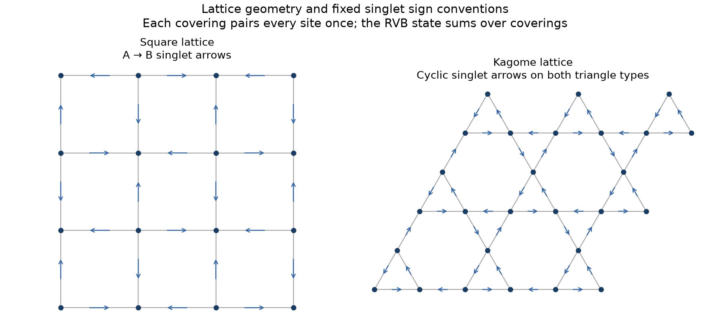

# RVB and dimer/trimer covering calculations

**[Download the latest collaborator notes (PDF, v3)](https://github.com/PepeGaRu/PEPS-CalculationsRVB/raw/refs/heads/main/Collaborator_Notes_v3.pdf)**
 · [View the PDF on GitHub](Collaborator_Notes_v3.pdf)
 · [Download the editable sources](https://github.com/PepeGaRu/PEPS-CalculationsRVB/raw/refs/heads/main/results/collaborator-notes/Collaborator_Notes_Source_v3.zip)

If the PDF opens in your browser, use its download button to save a copy.
If the repository is private, sign in to GitHub first.

For collaborators, the [revised four-page notes](results/collaborator-notes/Collaborator_Notes.pdf)
combine upright square–octagon diagrams, the eight local dummy-link coverings,
the loop map and 2D correlation diagnostics, the complete sixteen-state 3D model,
and the top-view layer construction with superposed dummy-link sites.
[Editable LaTeX and figure sources](results/collaborator-notes/Collaborator_Notes_Source.zip)
are included. The geometric layer relation is distinguished from an unproved quantum foliation.

The current target is the **three-dimensional bulk spin correlation length**
of the octahedral spin-1 singlet state. A cylinder keeps two dimensions small;
its correlation length does not answer that question. The
[3D calculation status](results/octahedral-spin1-bulk/report.md) records tests
on isotropic periodic boxes and exact singlet-overlap calculations. **No
converged bulk quantum correlation length has been obtained yet.** See the
[geometry diagram](results/octahedral-spin1-bulk/geometry.pdf) for the
difference between the earlier tube and the intended bulk limit.

The [new quantum correlation-length report](results/octahedral-spin1-cylinder/report.md)
and [PDF with decay plots](results/octahedral-spin1-cylinder/Spin1_Quantum_Correlation_Lengths.pdf)
now resolve **xi = 2.4901024** cubic-centre spacings for physical spin-1
singlet-projector correlations on an infinite **2x2 transverse cylinder**.
The tail alternates in sign and has an exponential envelope. An exact 2x3
width check gives **xi = 0.6381923** for the same transverse projector,
so a three-dimensional bulk length is not yet established.

```bash
/workspace/peps-environment/.venv/bin/python scripts/run_octahedral_spin1_cylinder.py
/workspace/peps-environment/.venv/bin/python scripts/check_spin1_cylinder_precision.py
```

The [spin-1 quantum report](results/octahedral-spin1/report.md) and
[PDF with quantum checks and plots](results/octahedral-spin1/Octahedral_Spin1_Quantum_Checks.pdf)
extend the octahedral model to singlet dimers and singlet trimers.
The [state definition](docs/octahedral-spin1-model.md) fixes the trimer phases
and gives an exact tensor network with virtual dimension four. This initial
report is a **24-spin periodic validation**; the newer cylinder report above
extends the length direction to infinity and measures the decay.

```bash
/workspace/peps-environment/.venv/bin/python scripts/run_octahedral_spin1.py
```

The [octahedral dimer/trimer report](results/octahedral-classical/report.md)
and [PDF with correlation plots](results/octahedral-classical/Octahedral_Classical_First_Results.pdf)
give the first calculation for the supplied three-dimensional covering notes.
For **equal-weight classical coverings**, binary parity constraints allow exact
counting and occupation probabilities. Local connected correlations vanish
beyond neighboring octahedra; nonlocal line constraints remain. The quantum
interpretation of the dimers and trimers is left open.

```bash
/workspace/peps-environment/.venv/bin/python scripts/run_octahedral_classical.py
```

The [square–octagon results and plots](results/octagon-square/report.md)
study your covering rule: unused dummy-edge spins pair with each other, so
every spin remains in a singlet. The [model and loop-map derivation](docs/square-octagon-model.md)
specify the geometry, signs and observables. Orthogonal-dimer occupation
correlations have **exactly finite range**. The singlet calculations support
short-range bond correlations with a characteristic scale of roughly
**0.8–0.9 simulation cells (one small square per cell)**; finite CTMRG convergence checks do not yet
establish a precise bulk length. See the [correlation plots](results/octagon-square/correlations.png)
and [decay diagnostics](results/octagon-square/decay-diagnostics.png).

The [spin-position diagram](results/octagon-square/spin-lattice.png) and
[enlarged cell](results/octagon-square/spin-unit-cell.png) show the graph used.
The intended loop map [contracts the dummy links](results/octagon-square/dummy-contraction.png),
giving a rotated square lattice with a bijection of even-edge configurations.
Our first diagram collapsed the small squares instead. Its 2^N multiplicity
belongs to that different projection; it does not apply to the user's map.
The simulation-cell axes join neighboring small-square centers and are diagonal
relative to the contracted square graph.

This program compares **nearest-neighbor spin-1/2 RVB singlets** with
**orthogonal dimer coverings**. It calculates connected dimer correlations,
checks the tensors against exact small systems, and produces figures and a
readable report. Python is already installed and configured in this cloud
environment; you do not need to write code to run it.

Start with the [paper recheck and new figures](results/paper-recheck/report.md),
the [findings and figures](RESULTS.md), the [exact benchmark results](results/reference/report.md),
the [correlation plot](results/reference/correlations.png), and the
[library and literature review](docs/libraries-and-references.md).
For a plain-language explanation, see [Reading the results](docs/reading-the-results.md).

The newly supplied square-RVB paper is audited in
[1009.1307v2](docs/paper-1009-audit.md). The
[decay-diagnosis guide](docs/decay-diagnostics.md) explains how we distinguish
exponential decay, power laws and numerical cutoffs for the next lattice.
Run `python scripts/analyze_decay.py` in the configured environment to
regenerate those diagnostics from the saved calculations.



## Run the calculations

In the repository terminal:

```bash
bash run.sh --profile reference --output results/reference
```

This runs the exact checks, square orthogonal-dimer plane and cylinder
calculations, kagome orthogonal-dimer calculation, and singlet RVB cylinders
at two widths per lattice, keeping both kagome virtual parity sectors
separate. It writes `data.json`, `report.md`, and figures in
`results/reference`. The calculation runs on CPUs; no GPU, MATLAB license,
API key, or external service is required.

For a shorter run with one circumference per lattice:

```bash
bash run.sh --output results/quick
```

To change only the measured range, add `--distance 48`. Increasing the
distance does **not** remove finite-circumference effects. Set
`RVB_NUM_THREADS=2` to choose the CPU thread count; two is the default here.
For a separate Python environment, set `RVB_PYTHON` to its interpreter path.

Independent infinite-lattice CTMRG runs using the existing `peps-torch` RVB
states are documented in [results/upstream](results/upstream) and reproduced
by the script in `scripts/`. These use a different approximation from the
exact cylinder calculations: finite CTMRG environment dimension `chi`.

```bash
/workspace/peps-environment/.venv/bin/python scripts/run_upstream.py
```

This runs several environment sizes and writes the raw logs, correlation
data, convergence information and a plot into `results/upstream`. Larger
sizes take longer; the saved reports record the settings actually used.

The new model has its own calculation and saved-result report commands:

```bash
/workspace/peps-environment/.venv/bin/python scripts/run_octagon.py --help
/workspace/peps-environment/.venv/bin/python scripts/plot_octagon_geometry.py
/workspace/peps-environment/.venv/bin/python scripts/summarize_octagon.py
```

The first command lists the CTMRG calculation options. The second draws the
spin lattice and dummy-link contraction. The third regenerates the correlation
figures and their source-data summary from saved data.

## What the comparison means

| Model | Quantity | Expected large-distance behavior |
|---|---|---|
| Square singlet RVB | Connected spin-bond / dimer correlation | Algebraic in the 2D limit; finite cylinders and finite `chi` introduce an eventual cutoff |
| Kagome singlet RVB | Connected spin-bond / dimer correlation | Exponentially decaying envelope, possibly with oscillations |
| Square orthogonal dimers | Connected dimer occupation | Exact plane power law proportional to `(-1)^r / (π² r²)` along the measured direction |
| Kagome orthogonal dimers | Connected dimer occupation | Strictly finite range; distant correlations vanish exactly |
| Decorated square–octagon singlet RVB | Connected physical spin-bond correlation | Current CTMRG data support a short-range tail; precise bulk length remains unresolved |
| Decorated square–octagon orthogonal dimers | Connected dimer occupation | Exactly zero beyond neighboring simulation cells (one small square per cell) |
| Octahedral dimers and trimers, equal-weight classical coverings | Connected single-octahedron occupation observables | Exactly zero beyond neighboring octahedron centres; quantum correlations are not calculated |
| Octahedral spin-1 singlet dimers and trimers | Physical singlet-projector correlations | Infinite 2x2 cylinder: alternating exponential, xi=2.49010; transverse 2x3 check: xi=0.63819. Bulk length undetermined |

The square power law is a statement about **dimer correlations**, not spin
correlations. Algebraic decay has no finite asymptotic exponential
correlation length. The singlet-RVB and orthogonal-dimer exponents need not
coincide.

For singlets the program measures `B = S_i · S_j` and
`C(r) = <B(0)B(r)> - <B(0)><B(r)>`. The singlet projector
`P = 1/4 - B` has the same connected correlation. Orthogonal dimers instead
measure occupation `n = 0 or 1`. A physical singlet projector is not an
occupation label in a nonorthogonal covering basis.

Singlet coverings overlap. For instance, the two coverings of a four-site
square have overlap `1/2` with the chosen A-to-B arrows. Removing these
overlaps changes the model and makes diagonal occupation calculations a
classical dimer problem. The program includes both calculations explicitly.

## Accuracy and scope

The PEPS bond dimension is exactly **D=3**, fixed by the RVB construction;
the program does not optimize a Heisenberg ground state. The custom cylinder
transfers are sparse and exactly contracted, apart from numerical
eigensolver precision. Supported substantive cylinder widths are square
4 and 6 sites, and kagome 2 and 4 three-spin unit cells.

Lengths count translations along the cylinder axis. One kagome translation
is twice the nearest-neighbor spacing. The code records the observable,
geometry, sector selection, eigenvector residuals, and fit diagnostics in
its JSON output. Use observable-coupled transfer modes, not an arbitrary
second eigenvalue, when interpreting a dimer correlation length.

Small-cluster agreement validates the construction; it does not prove a
thermodynamic exponent. Two cylinder widths alone are not a complete
finite-size extrapolation. Independent CTMRG data require their own `chi`
and iteration convergence checks. The result reports distinguish measured
values, exact reference formulas, and quantities not established here.

The uploaded **1203.4816v3** and **1202.0947v4** have now been read and audited.
The recheck fixes boundary-sector comparisons and distinguishes local dimer
lengths from topological energy-splitting scales. The paper's Eq. (12)
interpolation is implemented in `rvb/interpolation.py` and checked against
independently enumerated covering states. Figure 11's qutrit observable has
not yet been identified with our physical spin-bond convention, so its
extracted published points are shown separately from our new calculations.

To repeat the interpolation and redraw the paper-review plots:

```bash
/workspace/peps-environment/.venv/bin/python scripts/run_paper_kagome.py --help
/workspace/peps-environment/.venv/bin/python scripts/plot_paper_recheck.py
```

The first command lists the calculation parameters; saved JSON files record
the exact commands used. The second redraws the completed runs. See the
[paper recheck](results/paper-recheck/report.md) for convergence limits and
the next square-lattice reference needed.

## Install or refresh

The cloud environment keeps dependencies outside the source checkout in
`/workspace/peps-environment/.venv`. To recreate the core setup with Python
3.12 and `uv` available:

```bash
bash scripts/setup.sh
```

The checked-in `requirements.lock` pins all core/test dependencies with
artifact hashes; `requirements-paper.lock` pins the optional PDF extractor.
Installation preserves TLS and hash checks. To verify
without reinstalling:

```bash
/workspace/peps-environment/.venv/bin/python -m pytest -q
```

The independent upstream workflow also uses CPU-only PyTorch and its pinned
upstream source. To install these, also run `bash scripts/setup-upstream.sh`.
Its separate `requirements-upstream.lock` pins the CPU dependencies with
hashes. The upstream source is a dependency cache outside this repository;
its exact commit is recorded by the installer and result manifest.

## Extending to another lattice

`rvb/lattices.py` defines graphs and singlet directions;
`rvb/exact.py` enumerates small coverings and constructs an independent
spin-state and graph PEPS. These can validate a new lattice first.
`rvb/peps.py` contains the square and blocked kagome transfer constructions;
a new lattice generally needs a new block/transfer geometry.
`rvb/orthogonal.py` contains the classical exact solutions.
The new `rvb/square_octagon.py` implements the decorated graph, exact arrow
constraints and loop projection; `rvb/octagon_peps.py` implements its quantum
cell tensor and observables.

The kagome arrow solution and square Kasteleyn formula are specific to
those models. They must not be reused blindly for a different lattice.
The dense spin oracle deliberately refuses systems above 20 spins to
prevent accidental exponential memory use.
