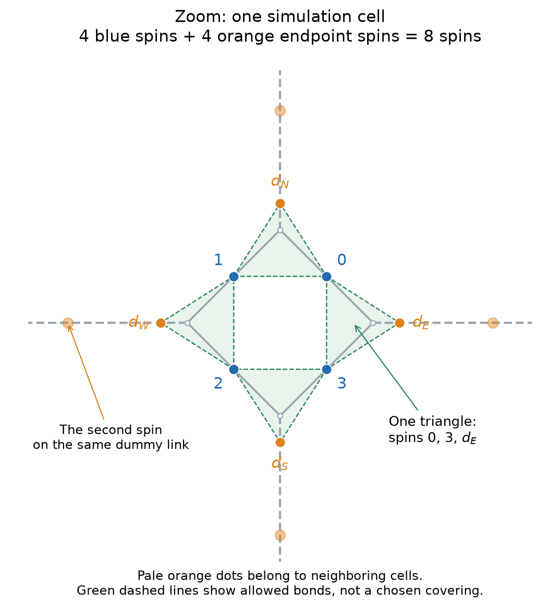

# The specified square–octagon covering model

The user confirmed two choices: both unused dummy endpoints form a singlet
along their dummy edge, and the quantum state has conventional equal
coefficients for all allowed oriented singlet coverings. There is no extra
semionic loop-count sign.

## Geometry and state

Small squares joined by dummy links form the trivalent square–octagon
(4.8.8) graph. Each of its vertices is replaced by a triangle of spin slots:

- A small-square edge carries one physical spin shared by its two adjacent
  triangles. That spin must belong to exactly one triangle singlet.
- A dummy edge carries two distinct physical spins, one at each endpoint.
  Either both are paired within their triangles, or they pair with each
  other along the dummy edge. There are no physical vacancies or free spins.
- Each triangle therefore has zero or one singlet, occupying zero or two
  of its three slots.

There are **eight physical spin-1/2 sites per simulation cell (one small square)**: four
shared square-edge spins r0…r3 and four endpoint spins dE,dN,dW,dS. The
allowed graph has twelve triangle bonds and two outgoing dummy bonds per
cell. Its perfect matchings are exactly the user's coverings.

The quantum state is

\[
|\Psi\rangle=\frac{1}{\sqrt{\mathcal N}}
\sum_{D\ \mathrm{allowed}}\ \bigotimes_{(i,j)\in D}
\frac{|\uparrow_i\downarrow_j\rangle-|\downarrow_i\uparrow_j\rangle}{\sqrt2}.
\]

The arrow convention is part of its definition: singlets circulate
counterclockwise around each triangle; dummy singlets point east/north.
Code orders each triangle as (r_k,r_{k-1},d_k), with k=E,N,W,S. Reversing
individual singlet arrows without compensating covering coefficients can
change the state. This is a fixed trial wavefunction, not an optimized
Hamiltonian ground state.

## The intended map: contract the dummy links

**Correction to the earlier explanation:** the user means erasing the dummy
links by contracting their endpoints together. Our earlier diagram instead
collapsed each small square to a vertex. These are different operations.
Dummy-link contraction is the intended map and does **not** have the earlier
claimed 2^N multiplicity. The physical spin graph and the numerical state
used in the calculations are unchanged.

Let a(v,e) be one when the slot at a base vertex v is paired in its triangle.
Every triangle has even occupation. On an ordinary edge,
a(v,e)+a(w,e)=1; on a dummy edge, a(v,e)=a(w,e). Subtract any valid reference
configuration modulo two. The differences agree at both ends of every base
edge and have even degree at every vertex. Since the base graph is
trivalent, each vertex has degree zero or two: the differences form
nonintersecting closed loops, including winding loops on a torus.

Now contract every dummy link. Their endpoints form a perfect matching of
the base graph, so each pair becomes one degree-four vertex. The surviving
small-square edges form a square lattice rotated relative to the array of
small-square centers. For N simulation cells this graph has **2N vertices
and 4N edges**.

This is a **bijection of even-edge configurations**. At either endpoint of
a contracted dummy link, its erased loop bit equals the sum modulo two of
the two surviving ring-edge bits. Even parity at the merged square vertex
makes the two endpoint answers agree. Thus all erased bits are uniquely
recoverable. The complete sequence is:

`singlet covering → reference-arrow loops on 4.8.8 → loops on the contracted square graph`.

Both loop graphs have **2^(2N+1)** even subgraphs on a connected periodic
torus, including all winding sectors. At a square vertex with four occupied
edges, inherit the strand pairing from the original split vertex. This
pairing is fixed by the construction; it is not an additional independent
choice of arbitrary crossing or reconnection.

See the [contraction clarification](octagon-contraction-clarification.md)
for reconstruction and routing details.

### The different projection used in the first diagram

The earlier [mapping figure](../results/octagon-square/mapping.png) collapses
each **small square**, retains dummy-link bits, and has only N vertices and
2N edges. This separate coarse projection has two local covering resolutions
per small square, hence 2^N preimages for every coarse even-edge pattern.
Its counting is correct for that operation, but it does not describe the
dummy-link contraction requested by the user. An internal loop may be lost
under that coarse projection; no such ambiguity occurs in reconstructing
the full even-edge pattern after dummy-link contraction.

## Orthogonal dimers versus physical singlets

If different coverings are orthogonal, equal amplitudes give uniform
covering probabilities. The intended bijection gives a uniform ensemble of
square **even subgraphs**, not the close-packed
square-lattice dimer ensemble studied earlier. Consequently the earlier
square-dimer r^-2 result does not apply to this new model.

Exact arrow counting gives triangle-bond occupation **1/4** and internal
dummy-singlet occupation **1/2**. Connected occupation correlations vanish
exactly beyond neighboring simulation cells. One convenient proof uses the
separate small-square-collapse projection described above. In the infinite plane,
its uniform square even subgraphs can be generated as domain walls of independent
fair dual Ising variables; distinct edge occupancies are pairwise independent.
On a torus, include boundary twists to generate all winding sectors. The local
resolution variables are independent between cells conditional on those
edges. A triangle-bond conditional mean is t/2 or (1−t)/2 for its incident
dummy edge, proving the stated finite support. The code also verifies all
joint probabilities against independent matching enumeration on small tori.

Physical singlet coverings overlap. Their norm is a sum over **pairs** of
coverings with spin-overlap weights and signs; it is not uniform classical
counting. The counting bijection alone therefore cannot determine quantum
correlations or a topological phase.

The singlet calculations measure connected physical **S_i·S_j** bond
correlations and spin correlations. The dummy-bond operator acts on its
two distinct endpoint spins. A physical singlet projector 1/4−S_i·S_j
has the same connected two-bond covariance, but is not a covering occupation
label in this nonorthogonal state.

Three loop notions remain separate: reference-arrow loops, their contracted
square representation with inherited routing, and bra–ket transition loops that determine
singlet overlaps. Nonlocal loop-connectivity correlations can differ from
local bond correlations even when the latter have finite range.

## Paper and implementation

The supplied [1407.7773v2](https://arxiv.org/abs/1407.7773v2), *Semionic
resonating valence bond states*, provides the reference-arrow construction
on kagome. Its semionic state includes an additional (−1)^number-of-loops;
the user chose the conventional state instead. Its numerical correlation
lengths and phase assignments do not automatically transfer to this lattice.
See the [paper audit](paper-1407-audit.md).

The exact PEPS has virtual bond dimension **3** and eight-spin physical
dimension 256 per cell. Its physical support compresses exactly to rank
**41**, without changing virtual dimension or introducing an environment
approximation. Amplitude-level torus contractions through sixteen spins
agree with independent covering sums, including all singlet signs.

`rvb/square_octagon.py` defines the graph, loop map and exact orthogonal
probabilities; `rvb/octagon_peps.py` defines the quantum tensor and physical
observables. `scripts/run_octagon.py` performs infinite-plane CTMRG, while
the exact-cylinder calculation checks boundary sectors separately. All
lengths are reported in **simulation-cell translations (one small square
per cell)**: one displacement between neighboring small-square centers.
These axes are diagonal relative to the square graph obtained by contracting
dummy links. Earlier plot and raw-data labels saying "original square cells"
refer to this simulation-cell convention, not to a nearest-neighbor step
of the contracted square graph. The numerical values are unchanged.

Results and their convergence limits are in
[the new-model report](../results/octagon-square/report.md).
