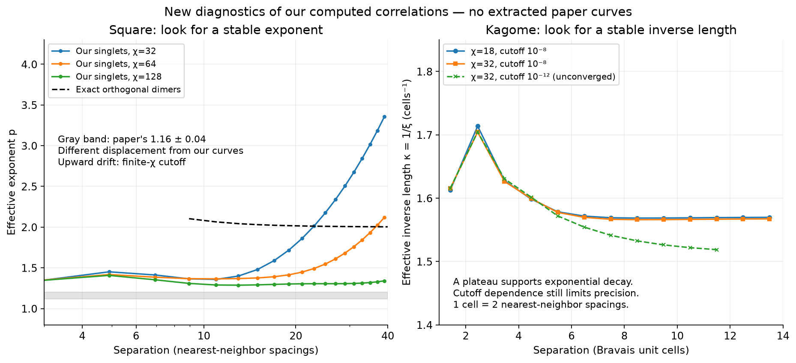

# Decay diagnostics of actual calculations

The second figure in the earlier answer was Schuch's published Figure 11 redrawn from PDF coordinates. It was not our reproduction. This report analyzes our saved numerical correlations and exact orthogonal benchmarks; no extracted paper curve is fitted.

The gray band is only Albuquerque–Alet's reported exponent 1.16(4), not sampled paper data. Their principal displacement differs from the collinear bonds measured here. The colored lines are diagnostics of our numerical data. The stricter kagome curve did not meet its iteration convergence criterion and diagnoses sensitivity rather than supplying a more accurate result.

## Descriptive fit windows

Fits below use equal weights in log magnitude. Log RMS residuals are fit-shape diagnostics, not independent statistical errors or proof of a bulk decay law. Branch 0/1 denotes even/odd separations. Compare windows and convergence settings, not just residuals.

| Dataset | Branch | Actual range | Points | Power exponent | Power log RMS | Exponential length | Exp. log RMS |
|---|---|---|---:|---:|---:|---:|---:|
| square_DD_chi64 | 0 | 4–12 | 5 | 1.3897 | 0.00473 | 5.3219 | 0.0908 |
| square_DD_chi64 | 0 | 6–20 | 8 | 1.3751 | 0.00201 | 8.6951 | 0.0897 |
| square_DD_chi64 | 0 | 10–30 | 11 | 1.432 | 0.0148 | 13.016 | 0.0601 |
| square_DD_chi64 | 0 | 20–40 | 11 | 1.6983 | 0.0225 | 17.084 | 0.0133 |
| square_DD_chi128 | 0 | 4–12 | 5 | 1.3539 | 0.00972 | 5.471 | 0.0935 |
| square_DD_chi128 | 0 | 6–20 | 8 | 1.3051 | 0.00453 | 9.1753 | 0.0897 |
| square_DD_chi128 | 0 | 10–30 | 11 | 1.2976 | 0.00132 | 14.422 | 0.0659 |
| square_DD_chi128 | 0 | 20–40 | 11 | 1.3102 | 0.000958 | 22.268 | 0.0266 |
| square_orthogonal_collinear | 1 | 17–31 | 8 | 2.0084 | 0.000301 | 11.688 | 0.0339 |
| square_orthogonal_collinear | 1 | 33–63 | 16 | 2.002 | 7.15e-05 | 23.434 | 0.0348 |
| square_orthogonal_collinear | 1 | 65–127 | 32 | 2.0005 | 1.77e-05 | 46.896 | 0.035 |
| square_orthogonal_collinear | 0 | 16–32 | 9 | 2.013 | 0.000604 | 11.588 | 0.0443 |
| square_orthogonal_collinear | 0 | 32–64 | 17 | 2.0031 | 0.000124 | 23.35 | 0.0397 |
| square_orthogonal_collinear | 0 | 64–128 | 33 | 2.0008 | 2.86e-05 | 46.818 | 0.0374 |
| square_orthogonal_transverse | 1 | 17–31 | 8 | 2.0084 | 0.000301 | 11.688 | 0.0339 |
| square_orthogonal_transverse | 1 | 33–63 | 16 | 2.002 | 7.15e-05 | 23.434 | 0.0348 |
| square_orthogonal_transverse | 1 | 65–127 | 32 | 2.0005 | 1.77e-05 | 46.896 | 0.035 |
| square_orthogonal_transverse | 0 | 16–32 | 9 | 4.036 | 0.00175 | 5.7798 | 0.0894 |
| square_orthogonal_transverse | 0 | 32–64 | 17 | 4.0082 | 0.000337 | 11.669 | 0.0794 |
| square_orthogonal_transverse | 0 | 64–128 | 33 | 4.002 | 7.66e-05 | 23.406 | 0.0747 |
| kagome_x_chi32 | all | 2–8 | 7 | 6.9096 | 0.586 | 0.62421 | 0.0445 |
| kagome_x_chi32 | all | 4–10 | 7 | 10.278 | 0.403 | 0.63588 | 0.0106 |
| kagome_x_chi32 | all | 8–14 | 7 | 16.784 | 0.253 | 0.6383 | 0.000477 |
| kagome_y_chi32 | all | 2–8 | 7 | 8.2257 | 0.658 | 0.52542 | 0.094 |
| kagome_y_chi32 | all | 4–10 | 7 | 11.941 | 0.446 | 0.54778 | 0.0333 |
| kagome_y_chi32 | all | 8–14 | 7 | 18.705 | 0.24 | 0.57329 | 0.041 |
| kagome_x_strict_chi32 | all | 2–8 | 7 | 6.89 | 0.575 | 0.62634 | 0.0531 |
| kagome_x_strict_chi32 | all | 4–10 | 7 | 10.156 | 0.382 | 0.64397 | 0.0253 |
| kagome_x_strict_chi32 | all | 8–12 | 5 | 15.02 | 0.125 | 0.65588 | 0.00385 |

## Interpretation and limits

- Square orthogonal collinear bonds approach exponent 2. Transverse bonds give exponent 4 on the even branch and 2 on the odd branch: a real leading-term cancellation, not a failure of the dimer model.
- Square singlet curves still move with chi. Their finite-window exponent near 1.30 is not a reproduction of 1.16(4), and an eventual finite-chi exponential tail is not a measured finite bulk dimer length.
- Kagome's approximately constant inverse length supports rapid exponential decay in the resolved range. Projector-cutoff sensitivity and unconverged stricter runs prevent a precise bulk-length claim.
- The exact kagome occupation zeros are supplied as exact combinatorial results. The generic numerical routine does not infer exact finite range from floating-point zeros.
- A mixed power-times-exponential fit is included in JSON with a scale-independent conditioning diagnostic. It has an extra parameter; a lower residual alone cannot establish its physical meaning.

The numerical floor is 1e-13 for this float64 dataset. It is a screening threshold, not a bound on CTMRG truncation error. Optional externally estimated absolute errors are supported by the reusable API. Signs, branch labels, excluded points and segment boundaries remain in the output; local derivatives never bridge unresolved points within a branch.

See [the diagnosis protocol](../../docs/decay-diagnostics.md), [the new paper audit](../../docs/paper-1009-audit.md), and [the full machine-readable output](data.json). Source hashes and convergence flags are included. No new infinite-plane CTMRG run was required for this analysis.

Repeat with `python scripts/analyze_decay.py`. The exact transverse orthogonal benchmark is reevaluated; all singlet inputs come from saved runs. For the next lattice, specify the state/covering superposition, allowed bonds, operator, direction, units and boundaries before fitting a decay.
