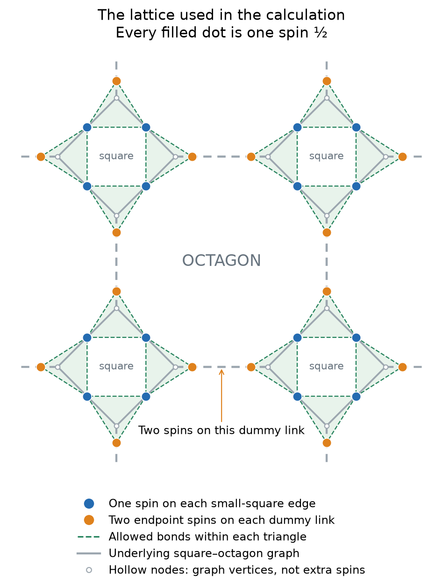
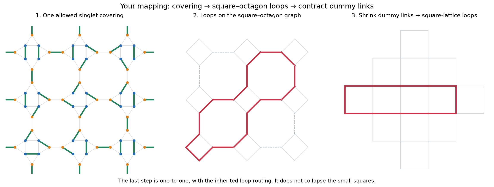
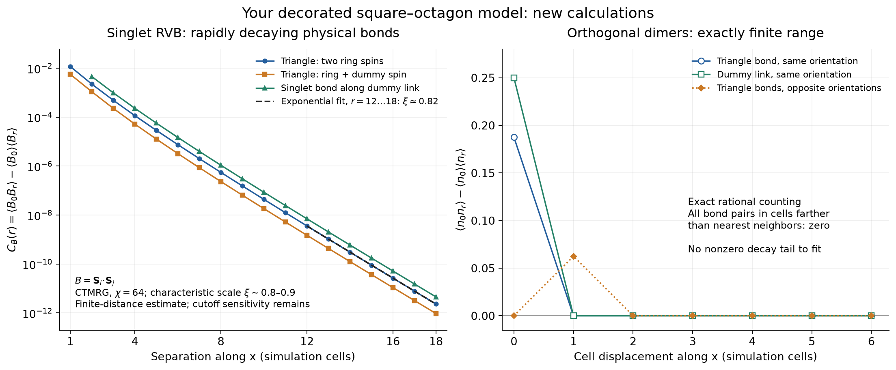
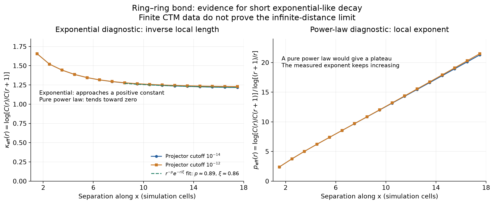
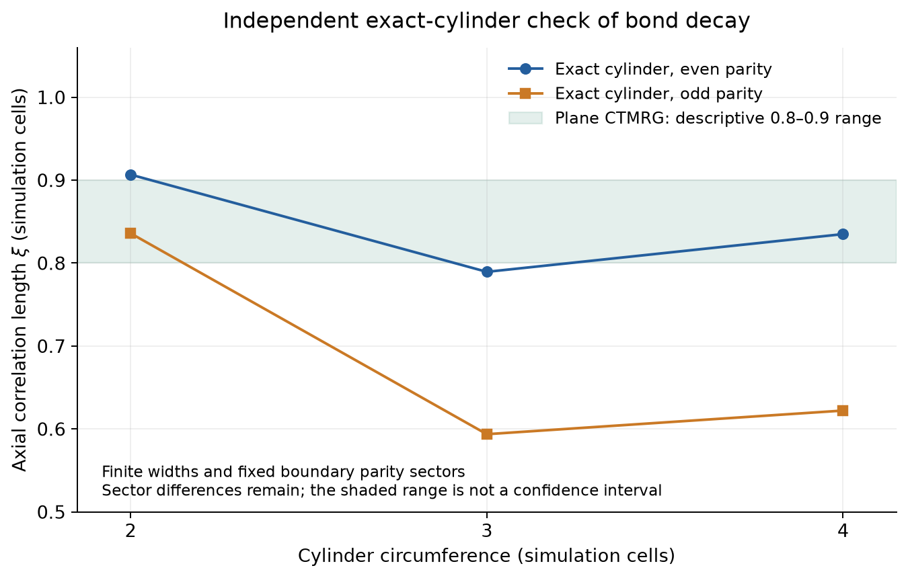

# Calculated correlations on the triangle-decorated square–octagon lattice

**The specified singlet RVB state has rapidly decaying physical bond correlations in the calculations performed, with a characteristic scale of roughly 0.8–0.9 simulation cells (one small square per cell).** The orthogonal-covering version has exactly zero connected occupation correlations beyond neighboring simulation cells. These are new calculations of the user's model; the figures below do not contain digitized Schuch-paper curves.

The singlet result supports an exponential envelope over the resolved distances. It is not yet a precision bulk correlation length or a proof excluding an eventual longer tail: finite-environment truncation still affects the small correlations, and finite cylinders retain appreciable width and sector dependence.

## State and geometry used

Small squares joined by dummy links form the trivalent square–octagon (4.8.8) base graph. There are **eight permanent spin-1/2 sites per simulation cell (one small square)**. A square-perimeter edge carries one spin shared by two triangles; a dummy edge carries two distinct endpoint spins. If both endpoints are unused by their triangles, they form a singlet along the dummy edge. Every physical spin belongs to exactly one singlet.

The wavefunction sums all allowed complete singlet coverings with **equal coefficients**, using this fixed arrow convention: counterclockwise triangle singlets and east/north dummy-edge singlets. There is **no additional semionic loop-count sign**. This is a fixed trial state, not an optimized Hamiltonian ground state. See [the model definition](../../docs/square-octagon-model.md) for the precise graph and tensor convention.





**Mapping correction:** the user's intended map contracts the **dummy links**, rather than collapsing the small squares as our first diagram did. Relative to a fixed reference covering, singlet coverings map one-to-one to even loop patterns on the trivalent graph. Contracting each dummy link then gives a rotated square lattice with 2N vertices and 4N retained ring edges for N simulation cells. This second step is also a bijection of even-edge patterns: the erased dummy bit is determined by the parity of the two retained ring edges at either of its original endpoints. At degree-four vertices the original split graph fixes how the strands connect.

The earlier 2^N multiplicity belongs only to the **different small-square-collapse projection**, retained in [the old diagram](mapping.png) for comparison. It does not apply to the dummy-link contraction requested by the user. This correction changes the geometric explanation, not the physical spin graph, singlet state, or computed correlation values. See [the detailed clarification](../../docs/octagon-contraction-clarification.md).

The contracted ensemble consists of **square even subgraphs**, not close-packed dimers on the square lattice. The earlier square orthogonal-dimer exponent 2 therefore does not apply to this model. A counting bijection also does not make the singlet norm a uniform loop count: distinct singlet coverings overlap and interfere.

## The calculated curves



The singlet curves measure the connected physical bond covariance

`C_B(r) = <B(0) B(r)> − <B(0)><B(r)>`, with `B = S_i·S_j`.

The tested bonds include two types inside a triangle—ring–ring and ring–dummy—and the actual dummy-link bond between neighboring cells. Dummy-link correlations use nonoverlapping two-cell insertions. All separations and lengths count **simulation-cell translations**, between neighboring small-square centers. These axes are diagonal relative to the contracted square graph. Earlier figure and raw-data labels saying "original square cells" mean this simulation convention, not nearest-neighbor steps on the contracted graph; no numerical values have been rescaled.

The orthogonal curves instead measure occupation covariance `C_n(r)`, where n is 0 or 1 for a chosen covering edge. Their amplitudes should not be equated with the physical spin-bond covariance. For physical spins, the singlet projector `1/4−S_i·S_j` has the same connected two-bond covariance as `S_i·S_j`, but it is not a covering-occupation label.

### Orthogonal coverings: exact finite range

Exact affine parity counting, with rational probabilities and no sampling noise, gives:

| Quantity | Exact value |
|---|---:|
| Occupation of an individual triangle bond | 1/4 |
| Occupation of the internal dummy-edge singlet | 1/2 |
| Connected occupation covariance beyond neighboring simulation cells | 0 |

The plotted same-orientation translated bond families can vanish already at smaller separations; the statement above bounds the support of general local bond-occupation pairs. These are independently established exact zeros, not values merely below numerical precision. There is no nonzero exponential tail to fit.

The result is checked against explicit matching enumeration. Its convenient analytic proof uses the separate small-square-collapse projection and its independent local resolutions; this auxiliary proof remains valid after correcting which map the user intended. Raw results are in [orthogonal.json](orthogonal.json). Local occupation statistics do not determine nonlocal loop-connectivity correlations or physical singlet correlations.

### Physical singlets: a short decay scale

The PEPS has virtual bond dimension 3. Its eight-spin local Hilbert space has dimension 256 and can be reduced **exactly** to its rank-41 support; this local basis reduction does not truncate the state. Infinite-plane contraction uses CTMRG, which does introduce an environment approximation.

In the selected contraction, chi=64 with relative projector cutoff 1e−14 and absolute multiplet cutoff 1e−18 retains 35 states in each final projector. The corner-spectrum iteration criterion is met after 22 iterations, with residual 5.03e−9 below tolerance 1e−8. Convergence of those iterations does not establish convergence of the long-distance tail with truncation.

For the resolved window **r=12…18 cells**, representative fits are:

| Physical bond, translated along x | Pure exponential length xi | Power times exponential: p, xi |
|---|---:|---:|
| Triangle ring–ring | 0.816 | 0.89, 0.858 |
| Triangle ring–dummy | 0.815 | 0.97, 0.861 |
| Horizontal dummy link | 0.816 | 0.90, 0.859 |

The models are `A exp(−r/xi)` and `A r^(−p) exp(−r/xi)`, respectively. These numbers describe a finite interval; their displayed digits document the fits, not physical precision. An exponential envelope with a power prefactor remains compatible with the curves, so **about 0.8–0.9 cells** is a more defensible characteristic scale than a many-digit length. A smaller residual for the three-parameter model alone does not establish that model or a universal p.

For the ring–ring bond, moving the pure-exponential fit from r=8…14 to r=12…18 changes xi from 0.800 to 0.816. A pure-power fit over the same two windows changes its exponent from about 13.4 to 18.1, without a stable exponent. Its log residual is substantially larger than the exponential residual. This behavior favors short-range decay over a pure power law **on the measured range**.



An inverse effective length approaching a positive value supports an exponential scale; a stable power-law exponent would instead appear as a plateau in the effective exponent. The diagnostics are interpreted only above the absolute correlation floor **1e−13** and alongside truncation checks. The floor is a numerical guard, not an estimate of systematic error. Spin correlations form a separate, faster-decaying, oscillating channel; values below the floor are not used to infer a tail.

### Remaining contraction uncertainty

At fixed chi=64 and absolute multiplet cutoff 1e−18, tightening the relative cutoff from 1e−12 to 1e−14 changes bond-correlation amplitudes by approximately **3% at r=14** and **7–8% at r=18**. These are sensitivity checks, not rigorous error bars.

Increasing nominal chi alone can be misleading: several earlier settings retained the same effective rank despite different chi. Some tighter-criterion runs also exhausted their iteration budget without passing. They are recorded as unconverged in the [full CTMRG report](ctmrg/report.md), rather than used as evidence of successful convergence. Centered insertions and direct connected subtraction were cross-checked using the same finite contraction strip; retaining consistent one-point normalization avoids artificial long-distance offsets.

The current evidence therefore supports a short resolved bond-decay scale, while a precise thermodynamic asymptote, rigorous exclusion of a much weaker unresolved tail, and a topological phase assignment remain open.

## Independent exact-cylinder checks

The raw physical tensor is also contracted on infinite cylinders of width 2, 3, and 4 simulation cells, without an environment truncation. Ket and bra virtual-vacuum parities are fixed to the same even or odd value; no vison is inserted. The reported lengths come from transfer modes with nonzero coupling to the physical observable.

| Circumference | Even-sector bond xi | Odd-sector bond xi |
|---:|---:|---:|
| 2 | 0.907 | 0.836 |
| 3 | 0.789 | 0.594 |
| 4 | 0.835 | 0.622 |



All three tested triangle-bond operators couple to the same leading scalar mode within each width and sector. Ring-spin lengths are much shorter, approximately 0.21–0.23 cells. Generic transfer gaps are not substituted for these observable-specific lengths.

The appreciable even/odd and circumference differences mean that these exact finite-cylinder calculations are **not a bulk extrapolation**. They independently support short physical channels on the tested cylinders and expose boundary effects that an unrestricted largest-eigenvalue selection could conceal. See [the cylinder report](cylinders/report.md) and its sector-resolved JSON files.

## Validation and provenance

Validation included **135 passing tests** across the project. Checks relevant to this model include:

- Independent perfect-matching enumeration through 2×2 cells, the parity mapping, and exact occupation joint probabilities. Five additional tests check dummy contraction, its unique inverse, and inherited loop routing, including exhaustive even-subgraph enumeration through 2×2 cells.
- Physical spin amplitudes on tori through 16 spins, comparing the PEPS with independent sums of oriented singlet coverings.
- Exact local rank-41 compression, with a raw dimension-256 contraction used as an additional numerical precision check.
- Factorized two-cell correlation insertions against dense small-physical-dimension operators in all four directions and against a polarized product state.
- Fixed-sector cylinder norms and bond means against covering sums on small tori, plus reconstruction of propagated correlations from the coupled transfer modes. Reconstruction errors are below 3e−15 and dominant fixed-point residuals below 2.1e−15.

The [CTMRG summary](ctmrg/summary.json) records fit windows, effective slopes, cutoff comparisons, and excluded points. Individual run JSON files record source hashes, versions, settings, iteration histories, and raw correlations. The plot inputs are listed in [figure-summary.json](figure-summary.json). The earlier small-square-collapse diagram retains [its machine-readable checked example](mapping-example.json); it is not the intended dummy-link contraction.

The [audit of arXiv:1407.7773v2](../../docs/paper-1407-audit.md) explains the borrowed arrow-map idea and why the conventional state here differs from that paper's semionic state. No paper's published numerical curves were substituted for these calculations. The current sources and confirmed geometry suffice for this analysis; no additional paper is needed at present.

## Reproduce the calculations

Run from the repository root in the prepared Python environment. The pinned `peps-torch` checkout and CPU PyTorch dependencies are required for CTMRG.

```bash
# Spin positions and the intended dummy-link contraction.
/workspace/peps-environment/.venv/bin/python scripts/plot_octagon_geometry.py

# Auxiliary small-square-collapse map and exact orthogonal probabilities.
/workspace/peps-environment/.venv/bin/python scripts/plot_octagon_mapping.py

# Exact cylinders, with both virtual parities explicitly selected.
OPENBLAS_NUM_THREADS=1 OMP_NUM_THREADS=1 \
  /workspace/peps-environment/.venv/bin/python -m rvb.octagon_transfer \
  --widths 2 3 4 --sectors even odd --max-distance 32

# Selected infinite-plane contraction.
/workspace/peps-environment/.venv/bin/python scripts/run_octagon.py \
  --chi 64 --distance 24 --projector-tol 1e-14 \
  --multiplet-abstol 1e-18 --ctm-tol 1e-8 --max-iter 120

# Companion cutoff check.
/workspace/peps-environment/.venv/bin/python scripts/run_octagon.py \
  --chi 64 --distance 24 --projector-tol 1e-12 \
  --multiplet-abstol 1e-18 --ctm-tol 1e-8 --max-iter 120

/workspace/peps-environment/.venv/bin/python scripts/summarize_octagon_ctmrg.py
/workspace/peps-environment/.venv/bin/python scripts/summarize_octagon.py
/workspace/peps-environment/.venv/bin/python -m pytest -q
```

Further convergence work should vary both retained environment dimension and the truncation cutoffs, compare several distance intervals and physical channels, and extend fixed-sector cylinders where feasible. The same tests and decay diagnostics are reusable for another lattice, but its tensor, spin graph, amplitudes, and observables must first be specified and checked.
