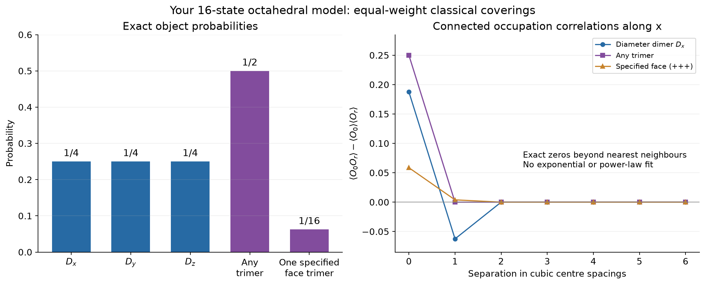

# First exact calculation for the supplied octahedral coverings

The sixteen-state rule is computationally tractable here. This benchmark uses **equal statistical weight for every complete allowed covering**, summed over all sectors. No quantum spin state, singlet overlap, object fugacity, or Hamiltonian is assumed.

The geometry and local objects follow the supplied two-page notes: cubic octahedron centres, shared covering sites at cubic bond midpoints, any subset of three opposite-vertex dimers or one of eight face trimers. Two complementary face trimers on one octahedron are excluded. Crossings of dimer chords at an octahedron centre do not introduce additional sites.

## Actual computations

| L | Octahedra | Covering sites | log2(number of coverings) | Binary solve (s) |
|---:|---:|---:|---:|---:|
| 3 | 27 | 81 | 35 | 0.0020 |
| 4 | 64 | 192 | 75 | 0.0041 |
| 6 | 216 | 648 | 233 | 0.0039 |
| 8 | 512 | 1536 | 535 | 0.0098 |
| 10 | 1000 | 3000 | 1029 | 0.0203 |
| 12 | 1728 | 5184 | 1763 | 0.0341 |

Times measure construction and solution of the binary constraint system in this running environment. Computing the cube-move rank, observables, validation tests and plots has additional cost recorded separately in `data.json`. The enormous covering counts are handled as linear spaces; these configurations were not enumerated on the large tori.

## Exact probabilities and correlations

Every local catalog state has probability 1/16. Thus each diameter dimer has probability 1/4, any trimer has probability 1/2, and each specified face trimer has probability 1/16. Mean object counts per octahedron are 3/4 dimers and 1/2 trimers. The mean occupied-site count is therefore `2*(3/4)+3*(1/2)=3`, consistent with 3N globally covered sites.



For periodic lengths at least three, **any two single-octahedron catalog variables at non-neighboring centres are independent**. All connected local-object correlations therefore vanish beyond nearest-neighbour centres. In particular, the x-dimer covariance at the x neighbour is -1/16, the same specified face-trimer covariance there is +1/256, and the any-trimer covariance is zero for every distinct centre. The exact zeros are not a numerical floor and must not be fitted to a positive exponential length.

Neighboring octahedra have 128 compatible catalog pairs, each of probability 1/128; compatibility requires opposite ownership of the shared site. Non-neighbors have all 256 catalog pairs with probability 1/256. The full matrices are saved in `data.json`. Period-two clusters exhibit additional finite-size correlations and are used only for validation.

## Counting, sectors and nonlocal structure

Let N=Lx Ly Lz and S=Lx+Ly+Lz. There are 3N ownership bits and 2N parity equations, with S-1 linear dependencies. Hence the rank is 2N-S+1 and the number of coverings is **2^(N+S-1)**. This formula counts distinct owner-labelled objects; small periodic tori can identify physical endpoint sets while retaining different geometric object locations.

The elementary cube-flip span has rank N-S+2, leaving **2^(2S-3)** classical sectors inaccessible to cube-only updates. Independent free-bit sampling in this code includes all sectors and has no equilibration or local-update trapping.

Even though two-point local tails vanish, nonlocal constraints remain. If T_v indicates a trimer, its XOR along every periodic coordinate line equals the line length modulo two. The statistical ensemble is therefore not a product of independent octahedron states. Neither finite-range local correlations nor counting classical cube-move sectors by itself establishes a quantum fracton phase.

The counting formulas follow by writing a dependency of the xy and xz checks as lambda_xy=h(x)+f(z), lambda_xz=h(x)+g(y), with one redundant common constant. Cube-flip relations have coefficients u(x)+v(y)+w(z), with two redundant constants. Local independence can be seen by surrounding-cube flips: away from nearest neighbours they span the full four-bit catalog at either octahedron without changing the other.

## Relation to the cited papers

[Benton and Moessner, arXiv:2103.10817](https://arxiv.org/abs/2103.10817), Figure 3, supports the corner-sharing octahedral geometry. [Stern et al., arXiv:2603.12313v2](https://arxiv.org/abs/2603.12313v2), Section V, instead requires equal incoming counts along the three axes as integers: empty, eight faces and full, giving ten states. The present rule equates these counts only modulo two and includes six additional partial-dimer supports. The cited U(1) model's entropy, algebraic correlations and pinch-line features cannot be assigned to this sixteen-state model.

## Reproduction and next calculations

The independent validation in `tests/test_octahedral.py` enumerates geometric
coverings directly on a 2x2x2 periodic cluster, without using the binary
equations. It finds 8,192 distinct owner-labelled coverings, in one-to-one
agreement with the arrow solutions, and checks their joint probabilities.
The 19 tests also check exact site coverage, local rules, cube moves, rank
formulas, finite-range correlations and the nonlocal line-parity constraint.

```bash
/workspace/peps-environment/.venv/bin/python scripts/run_octahedral_classical.py
/workspace/peps-environment/.venv/bin/python -m pytest -q tests/test_octahedral.py
```

The implementation is `rvb/octahedral.py`; `data.json` contains exact fractions, timings and source hashes, and `sample-covering.json` contains a checked 4x4x4 covering with every site covered once. The PDF is [Octahedral_Classical_First_Results.pdf](Octahedral_Classical_First_Results.pdf).

Possible next steps are weighted dimers/trimers, restricted local catalogs, nonlocal cage observables and sector comparisons. The parity solver gives exact unweighted samples, but nonuniform weights require a separate weighted algorithm or controlled reweighting. The quantum interpretation remains postponed as requested.
