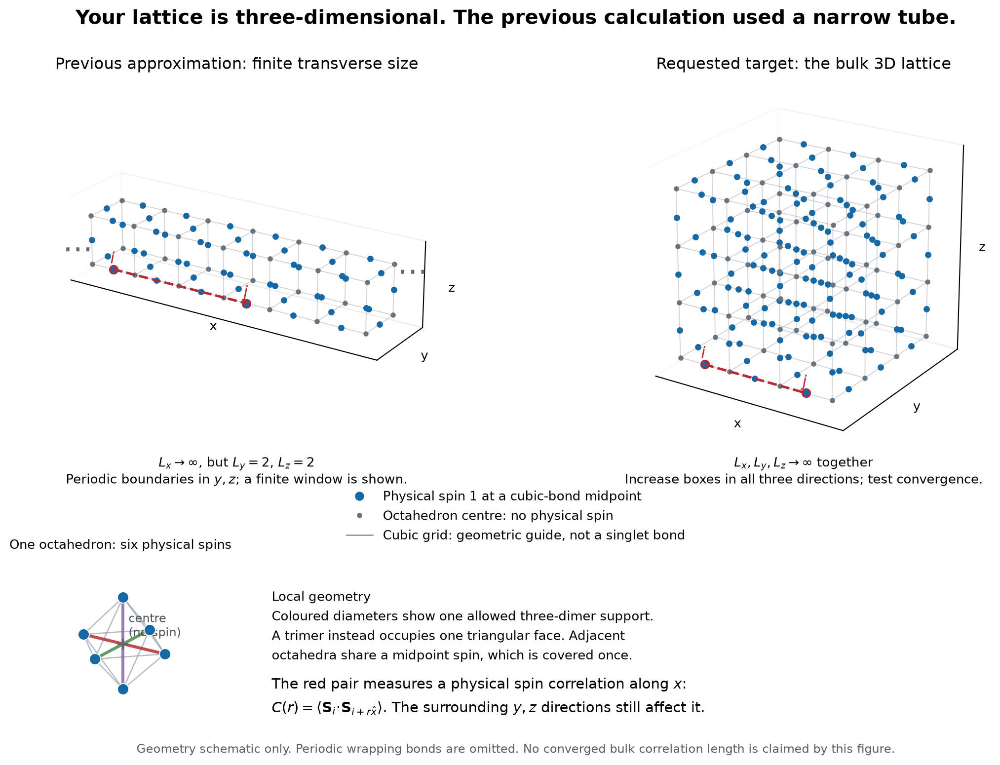
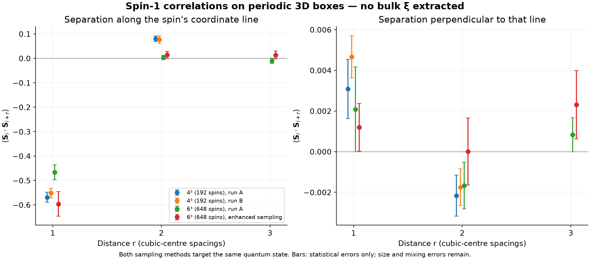

# Three-dimensional spin-1 calculation: feasibility and current limits

**A bulk quantum correlation length has not yet been established.**
The calculation is possible in principle, and the code now evaluates
singlet-covering overlaps on genuinely three-dimensional periodic boxes.
Obtaining a reliable decay length requires more than a nonzero correlation
on a small box: both the box-size error and the numerical approximation
must be controlled.

The previous cylinder results keep the transverse dimensions at 2x2 or
2x3 while extending the length to infinity. They are valid results for
those tubes, but are not the requested three-dimensional bulk result.

[Open the PDF with the geometry and new 3D spin plots](Three_Dimensional_Spin1_Status.pdf).



## State and observable

We retain the [specified spin-1 state](../../docs/octahedral-spin1-model.md):
equal coefficients for all allowed coverings made from normalized diameter
singlets `delta/sqrt(3)` and axis-ordered face singlets `epsilon/sqrt(6)`.
Every physical spin is a midpoint of a bond between cubic octahedron centres.

The simplest target is a two-spin correlation along x,

\[
C_S(r)=\langle\mathbf S_{(1/2,0,0)}\cdot
\mathbf S_{(r+1/2,0,0)}\rangle
=3\langle S^z_{(1/2,0,0)}S^z_{(r+1/2,0,0)}\rangle .
\]

The spin means vanish because the state is a total-spin singlet, so this
already is a connected correlator. Distances are in cubic-centre spacings.
The two sites belong to the x-directed physical-site sublattice, making
the displacement parallel to the line containing those midpoint spins.
The sampling also measures transverse displacements as a separate check.
Rotating
both the displacement and the site orientation gives equivalent cubic
directions; longitudinal and transverse site choices need not give the
same amplitudes or reveal exactly the same modes.

For exponential decay the asymptotic envelope has slope `-1/xi` on a
semilogarithmic plot. A power law has no finite asymptotic exponential
correlation length. Possible oscillations, algebraic prefactors, finite
periodic images, and the numerical noise floor must be included in that
diagnosis. A 3x3x3 torus provides only one nonzero independent axial
distance, and a 4x4x4 torus only two; these cannot establish an asymptotic
decay law by themselves. A spin correlation length also need not equal a
singlet-projector correlation length.

There is an additional parity effect: on a periodic line of length L,
the number of trimer centres has parity L. Odd and even boxes therefore
impose different constraints. An eventual size study should compare an
even-size sequence, such as 4, 6, 8, while also checking the other allowed
sectors; the 3x3x3 box is primarily an algorithm diagnostic.

## Actual 3D methods tested

Two complementary approaches use all three finite dimensions and are
being checked against exactly contracted small systems:

1. **Three-dimensional tensor contraction.** The exact local tensor has
   virtual dimension four. Its norm can be compressed exactly to an
   eight-state edge space before approximate 3D contraction. Increasing
   the retained dimension `chi` tests the additional truncation. A
   physical spin insertion must be made before this norm compression,
   because the operator can access components absent from the norm edge.
   Numerators and denominators must use a consistent environment.
2. **Exact overlap sampling.** A pair of coverings is contracted exactly
   after eliminating dimer Kronecker deltas. The remaining trimer networks
   are evaluated with arbitrary-precision integer arithmetic. Sampling
   pairs with their overlap weights would include the quantum interference;
   independent uniform classical samples do not do so efficiently.

The norm tests already show strong truncation dependence. The coarsest
3x3x3 calculation even produces a negative norm and is rejected. A simple
independent lower bound proves that the exact state is nonzero: assign
Cartesian colour x, y, or z to each physical spin according to its cubic
bond direction. Every covering then has positive amplitude. For 3x3x3,
exact enumeration of the 256 possible trimer-indicator fields gives the
amplitude `2.88246884536`, hence the rigorous bound
`<Psi_un|Psi_un> >= 8.30862664448`.

Individual overlap contractions are much easier than the full covering
sum. Initial exact tests include 430 independent covering pairs on 3x3x3
(81 spins) and 30 on 4x4x4 (192 spins). All these overlaps were positive;
this finite sample is **not a proof that the model is sign-free**. Typical
independent pairs have extremely small overlaps, so directly averaging
them is not a reliable importance-sampling strategy.

The overlap program includes both single-cube and whole-coordinate-line
updates. Together these moves span the full allowed binary covering space
on the tested boxes. Line moves are substantially better than cube moves
at leaving a diagonal bra/ket pair on 4x4x4. Equilibration, statistical
errors, and larger-box checks remain necessary before interpreting a
sampled decay curve as a bulk result.

## What would constitute the requested result

A defensible estimate needs measured `C_S(r)` over several useful distances,
agreement when all three box dimensions increase, and agreement when the
contraction accuracy or Monte Carlo statistics improve. Merely fitting
two distances, extrapolating the previous narrow tubes, or substituting
classical occupation correlations would not establish that result.

## Measured finite-box quantum correlations

The overlap sampler has now run on periodic **4x4x4 boxes (192 spins)** and
**6x6x6 boxes (648 spins)**. These are full three-dimensional boxes, with no
fixed narrow transverse direction. Each pair contraction is exact; the
finite Monte Carlo average still has statistical and equilibration errors.



For the parallel spin correlation defined above:

| Box and run | C(1) | C(2) | C(3) |
|---|---:|---:|---:|
| 4³, 100,000 moves, diagonal start | -0.569 ± 0.021 | +0.080 ± 0.012 | — |
| 4³, 100,000 moves, independent start | -0.551 ± 0.019 | +0.077 ± 0.015 | — |
| 6³, 20,000 moves, standard sampling | -0.467 ± 0.031 | +0.003 ± 0.009 | -0.010 ± 0.011 |
| 6³, 30,000 moves, enhanced sampling | -0.596 ± 0.050 | +0.014 ± 0.015 | +0.014 ± 0.016 |

The first quarter of each run is discarded. The quoted errors use a
20-block delete-one-block jackknife of the reweighted expectation ratio.
They are **statistical diagnostics, not total error bounds**: incomplete
equilibration and finite-size effects remain. In particular, the two 6³
nearest-neighbour estimates differ by about 2.2 combined block errors,
which calls for longer chains and further mixing checks. Transverse
estimates often have only a handful of nonzero contributions.

The substantial drop of C(2) between 4³ and 6³ means that fitting the 4³
points would be misleading. On 6³ the parallel r=2 and r=3 signals are
not resolved from zero with these statistics. This does not prove the
true correlator vanishes. Neither an exponential nor a power law is
established by these points.

The enhanced sampler increases the weight of pairs with different trimer
location fields by a factor of 100, then divides both observable and norm
estimators by the same factor. It targets exactly the same state in the
equilibrated limit. The overlap sign is retained; no sign-free assumption
is needed. No negative overlaps were encountered in these runs, but that
is not a general positivity proof.

An exact finite-size check explains why line moves need care: changing
one complete coordinate line in a diagonal covering has overlap
`3**(1-(L+t)/2)`, where t is the number of trimer centres on that line.
For L=4 the possible values are 1/3, 1/9, and 1/27. These winding overlaps
shrink with circumference and can produce conspicuous small-box effects.

An independent approximate tensor contraction on the **3³ box**, retaining
chi=4, gives `Czz(r=1) = 6.33571204803e-5` for y-directed sites separated
along x. The shared norm environment and the physical operator support
are checked, but this value has no controlled truncation error. Norm
estimates on the same box change from `log10(Z)=10.94815` at chi=4 to
`11.95653` at chi=8, a factor of 10.20. This tensor result is saved as an
algorithm diagnostic and is not combined with the Monte Carlo estimates.

## Reproduce and inspect

- [Finite-box spin data and statistical diagnostics](spin-sampling-summary.json).
- [Raw overlap and Monte Carlo records](../octahedral_bulk_overlap/summary.json).
- [Norm truncation trials, including rejected and stopped runs](norm-probes.json).
- [Approximate 3³ tensor spin insertion](spin-L3-chi4.json).
- [Exact overlap and physical spin kernel](../../rvb/octahedral_spin1_overlap.py).
- [Exact 3D tensor geometry and operator construction](../../rvb/octahedral_spin1_bulk.py).

```bash
OPENBLAS_NUM_THREADS=2 OMP_NUM_THREADS=2 NUMBA_NUM_THREADS=2 \
  /workspace/peps-environment/.venv/bin/python \
  scripts/octahedral_bulk_overlap_sampling.py \
  --L 6 --steps 30000 --seed 99295 --initial diagonal --bias 100

MPLCONFIGDIR=/workspace/peps-environment/matplotlib \
  /workspace/peps-environment/.venv/bin/python scripts/plot_octahedral_bulk_sampling.py
```

Independent checks cover normalized singlet correlations, non-diagonal
physical spin matrix elements against raw tensor contraction, the exact
cube and winding-line overlaps, completeness of the move generators,
exact open-box contractions, and reuse of norm projectors for tensor
observables. These validate the implementation, not bulk convergence.

The current evidence supports further numerical work on the actual 3D
state. It does **not** yet establish whether this state's bulk spin
correlation is exponential, a power law, or exactly finite range, and no
numerical bulk `xi` is quoted.
