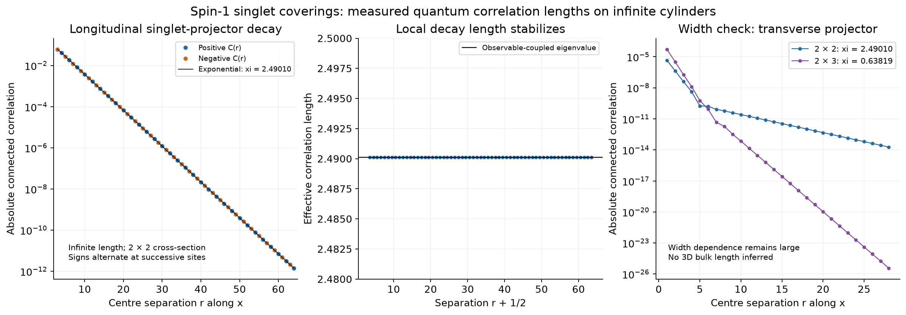

# Resolved quantum correlation lengths for spin-1 singlet coverings

**The infinite 2x2 cylinder has a physical singlet-projector correlation length
xi = 2.4901024017 cubic-centre spacings.** This is a new quantum
calculation including covering overlaps, using the equal-coefficient,
normalized-singlet state defined in [the model notes](../../docs/octahedral-spin1-model.md).
The earlier classical zero-tail result is not used to infer this length.

## Measurement and geometry

Octahedron centres have integer coordinates and the physical spin-1 sites
are cubic-bond midpoints. The x direction is infinite. The transverse y,z
directions are periodic with two centres each.

The principal observable is the physical singlet projector P_x(v) on the
sites v-e_x/2 and v+e_x/2, where `P = ((S_i · S_j)^2 - I)/3`.
We measure `C(r) = <P_x(0) P_x(r e_x)> - <P_x>^2`.
The mean is 0.482091798498. Each transfer step translates
one cubic-centre spacing. The implementation uses an exact three-slice
insertion and stores non-overlapping insertion blocks at r >= 3; shorter
distances are not assumed zero.



## The measured tail

The leading observable-coupled eigenvalues are
`lambda_0 = 306.733349269345` and
`lambda_dimer = -205.282871865273`. Consequently
`q = lambda_dimer/lambda_0 = -0.669255144099` and
`xi = -1/log|q| = 2.490102401688`.
The negative q gives an alternating tail. With the three-slice convention,
`C(r) ~ -0.061642660378 * (-0.669255144099)^(r-3)`.
Its magnitude decays exponentially; a negative correlator is not a failure
of the decay fit. The asymptotic term couples strongly to this observable.

Independent fits of the actual propagated envelope give:

| Distance window | Fitted xi |
|---|---:|
| 6–16 | 2.490102401151 |
| 12–28 | 2.490102401688 |
| 24–48 | 2.490102401688 |

The centered propagation removes the disconnected contribution algebraically.
It does not obtain a tiny tail by subtracting two order-one numbers.
The spectral and direct correlation curves agree within
2.22e-16 in absolute value.
The maximum norm-eigenvector residual in the 164-dimensional selected block
is 2.2e-16 with the recorded normalization.

The transverse diameter projector P_y has the same asymptotic length on this
cylinder, but its leading weight is only about -9.53e-10. Short-distance fits
can instead see a faster transient with xi about 0.426. An independent
eight-dimensional SU(2)-scalar reduction evaluated at 80 digits confirms
the weak tail and the eigenvalue ratio. That precision audit also compares
unrounded input matrices with rationally reconstructed matrices; the length
changes by about 2e-15. See [high-precision data](high-precision.json).

For comparison, the physical single-spin correlation `<S_z(0)S_z(r)>`
on outgoing y sites has asymptotic xi = 0.4182119106.
Spin and dimer lengths describe different operators and need not agree.

## Wider-cylinder check

For the same transverse P_y observable, the exact 2x3 periodic transverse
section gives **xi = 0.6381922941**. Its mean is
0.670695369138. The dominant boundary block has 976 states;
it is retained in full. The two leading parity sectors have equal dominant
eigenvalues and identical means/correlations. Their cross-sector radius is
275.501160, well below lambda_0 = 1004.632467.
All sixteen diagonal sectors were compared. The mixed-sector spectral
radii are bounded by the geometric means of their diagonal-sector radii;
the cross block between the tied leaders was checked explicitly.

The leading transverse modes on 2x3 are close in decay rate, so a finite-window
fit need not equal the ultimate largest-coupled-eigenvalue length exactly.
All coupled modes and direct data are saved. Odd versus even transverse
periods also change the allowed layer patterns. These two widths are not
a converged scaling sequence. **The bulk three-dimensional correlation
length and bulk exponential-versus-algebraic classification remain open.**

## Boundary sectors and a misleading long scale

The 2x2 norm transfer has 4,096 compressed states and 29,216
nonzero entries. Its 64 invariant bra/ket ownership blocks have at most
164 states. The largest norm eigenvalue occurs uniquely in sector 0.
This is the infinite-x limit of the finite periodic equal-covering sum.

Other sectors have nearly equal norm growth rates. Using the unrestricted
second eigenvalue would produce a scale of approximately
8859.43 cells. It is a sector-selection scale, not this
local dimer correlation length: the physical insertions preserve the
ownership sectors and do not couple the two leading sectors. It also means
that a short finite torus summed over sectors need not approximate the
infinite-cylinder sector mixture. In separately fixed diagonal sectors,
the longitudinal local lengths range from
2.4901024 to 2.4924904.
This small sector variation is not an error bar for increasing the width.

## Validation and reproducibility

The transfer exactly retains the rank-eight support of every unobserved
physical-edge norm metric. Observed edges are inserted before this compression,
including the components that lie outside the norm support. Both the
longitudinal and transverse projector constructions reproduce independently
computed physical quantities on the 24-spin torus.

An additional rotation check contracts the same 36-spin 3x2x2 torus in two
directions: `Tr(T_2x2^3)` and `Tr(T_2x3^2)`. Summing all sectors gives
507312110.356982588768 and 507312110.356983006001, relative difference
8.22e-16. This checks the wider geometry independently of fitting.
Other tests include local spin symmetry, complete covering sums, identity
insertions, a directly constructed twelve-spin state and the dimer-only limit.

```bash
/workspace/peps-environment/.venv/bin/python scripts/run_octahedral_spin1_cylinder.py
/workspace/peps-environment/.venv/bin/python scripts/check_spin1_cylinder_precision.py
```

The main calculation and sector checks took 16.16 seconds here,
excluding plotting and tests. Exact finite width means no tensor truncation;
the standard eigenanalysis uses floating-point arithmetic. Numerical precision
within a fixed tube is distinct from the physical uncertainty of its width.
The optional precision check uses mpmath, already installed in this environment
and available as the project's `precision` extra.

- [PDF with the measured lengths and plots](Spin1_Quantum_Correlation_Lengths.pdf)
- [Raw correlations, spectra, fits and source hashes](data.json)
- [80-digit reduced-matrix check](high-precision.json)
- [2x2 transfer implementation](../../rvb/octahedral_spin1_transfer.py)
- [2x3 transfer implementation](../../rvb/octahedral_spin1_width.py)
