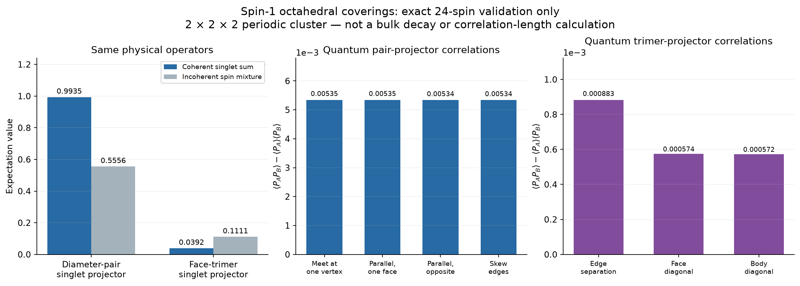

# Spin-1 singlet coverings: exact construction and a small quantum benchmark

Spin 1 gives a unique singlet for both dimers and trimers. We have implemented
the equal-coefficient covering superposition, including nonorthogonal overlaps.
The [model definition](../../docs/octahedral-spin1-model.md) specifies the
normalized tensors, phases and exact tensor-network representation.

**This is a 24-spin validation, not a calculation of the bulk quantum
correlation length.** The periodic 2x2x2 geometry has a severe identification
of dimer states, described below. Its correlations must not be fitted to a
bulk exponential or power law.

## State and observables

Each covering is a product of normalized spin-1 singlets: a symmetric
Cartesian delta/sqrt(3) for each dimer and epsilon/sqrt(6) for each trimer.
Trimer sites are ordered by the x, y, z axes for all eight faces.
All complete owner-labelled coverings have equal wavefunction coefficients.
There are no added orthogonality flags, fugacities or Hamiltonian assumptions.

The rank-six octahedron tensor and shared-site ownership tensor have virtual
dimension four (one vacuum plus three spin states). They define the state
on larger lattices too; the exact contraction below exploits a special small
torus and does not provide a scalable bulk contraction algorithm.

We measure physical singlet projectors, not classical object occupations:
`P_D = ((S_i · S_j)^2 - I)/3` for a diameter pair, and
`P_T = |t><t|` for a face trimer. Connected correlations are
`<P_A P_B> - <P_A><P_B>`.

## Exact overlap and complete covering sum

For the eight-trimer and twelve-dimer configurations related by one cube flip,
the overlap is **1/39,366**. It follows from the 24 positive three-edge-colourings
of the cube and the normalization factor `3^6 * 6^4`. This local overlap check
also applies on a larger torus.

On the 2x2x2 torus, the 8,192 coverings divide into 4,096 all-dimer coverings
and 4,096 all-trimer coverings. Let D be the normalized dimer product and T
the all-plus reference trimer product. The full unnormalized state is
`4096 D + G T`, where `G` is the product of `(I + Swap)` on twelve disjoint
physical spin pairs.

| Contribution to the unnormalized norm | Exact value |
|---|---:|
| Dimer part | 16777216 |
| Trimer part | 31831808/243 |
| Dimer–trimer interference | 16777216/19683 |
| Total norm squared | 332821096192/19683 |

These are integer tensor contractions with normalization restored as rational
fractions. No sampled covering average, tensor truncation or full `3^24`
state vector is used. Computing the reported norm, means and correlations
took 3.224 seconds in this environment, excluding plotting and tests.

## Physical projector results

| Observable | Coherent singlet superposition | Incoherent spin-covering mixture |
|---|---:|---:|
| Diameter-pair singlet projector | 0.9935441381 | 5/9 = 0.5555555556 |
| Specified face-trimer singlet projector | 0.0391528234 | 1/9 = 0.1111111111 |

The comparison mixture is `rho = (1/8192) sum_C |C><C|` of normalized
**physical spin states**, with the same projectors on both sides.
It is different from the earlier orthogonal-label model. For example,
the classical occupation probability 1/4 for a particular owner-labelled
dimer is not a physical singlet-projector expectation.

In the incoherent mixture, half the coverings are all dimers. Their physical
diameter pairs are singlets; the other half give 1/9 for a chosen pair.
For a face projector, the dimer sector gives 1/27. In the trimer sector,
the eight ownership patterns give one case with expectation 1, three with
1/9, and four with 1/27, averaging to 5/27. Hence the full mixture's face
expectation is 1/9.



The diameter pairs are the twelve disjoint spin pairs represented by edges
of a cube. The four plotted classes describe their relative cube-edge
geometry, not four distances along a bulk lattice direction. All-plus
reference faces at different centres also have disjoint physical supports;
their plotted projector products commute. Exact fractions for every plotted
value are saved in `data.json`.

## What the finite-size artifact means

Opposite geometric chords have the same physical endpoints on a period-two
line. Therefore all 4,096 dimer coverings give the **same** normalized spin
state, so their amplitudes add before the norm is taken. This strongly enhances
the dimer part and explains why its pair-projector mean is near one.
That number is not evidence for bulk dimer order. The nonzero connected
correlations shown here likewise do not establish a bulk decay law.

The earlier exact finite-range result remains a result about uniform
classical covering occupations. It cannot be carried over to the spin-1
superposition. The **bulk quantum correlation length remains undetermined**;
it requires larger geometry with controlled contraction or a separately
validated sampling method.

## Spin one-half alternative

Three spin-one-half particles decompose into two spin-1/2 doublets and one
spin-3/2 quartet. Neither choice is a singlet. A doublet also has a
multiplicity degree of freedom, so choosing its total spin alone does not
fix the internal trimer state. The remaining effective spins on trimers
need an additional state or coupling prescription. Spin 1 is the direct
choice when every local dimer and trimer should itself be a singlet.

## Reproduce and inspect

The independent tests check total spin zero and singlet projectors using
spin matrices, enumerate all `3^12` cube-edge colourings for the overlap,
and compare tensor contractions with dense twelve-spin calculations.
They also verify all 8,192 covering labels, the special dimer-state
identification, and SU(2) invariance of the general dimension-four tensors.

```bash
/workspace/peps-environment/.venv/bin/python scripts/run_octahedral_spin1.py
/workspace/peps-environment/.venv/bin/python -m pytest -q tests/test_octahedral_spin1.py
```

- [PDF with the quantum checks and plots](Octahedral_Spin1_Quantum_Checks.pdf)
- [Exact fractions and calculation metadata](data.json)
- [State definition and tensor construction](../../docs/octahedral-spin1-model.md)
- [Quantum implementation](../../rvb/octahedral_spin1.py)
- [Classical results, a different ensemble](../octahedral-classical/report.md)
