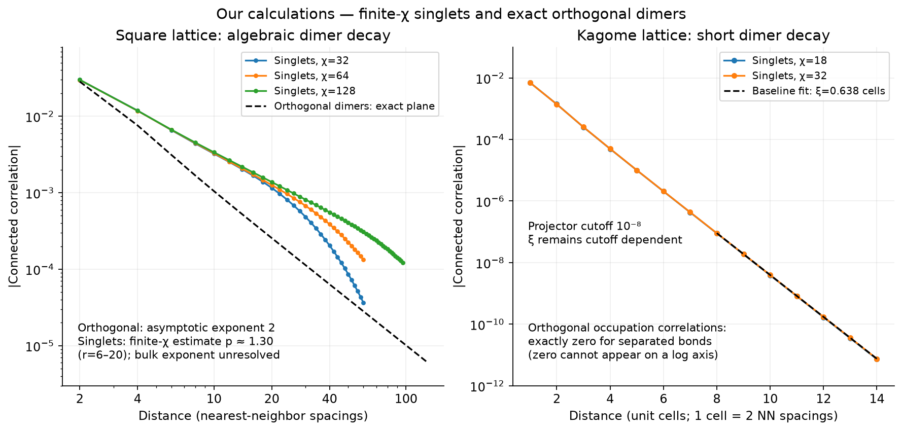
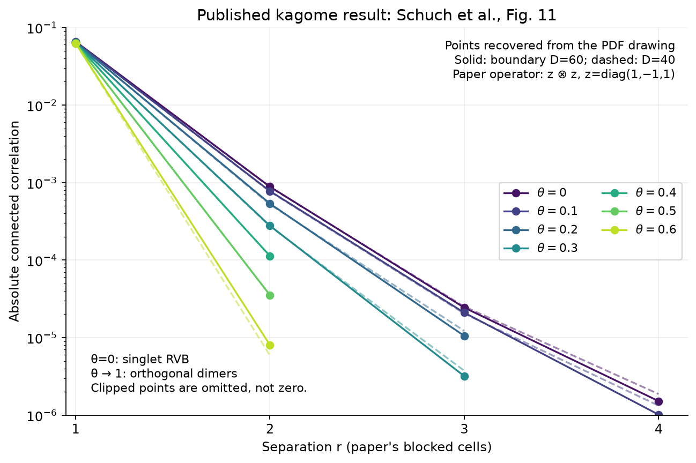
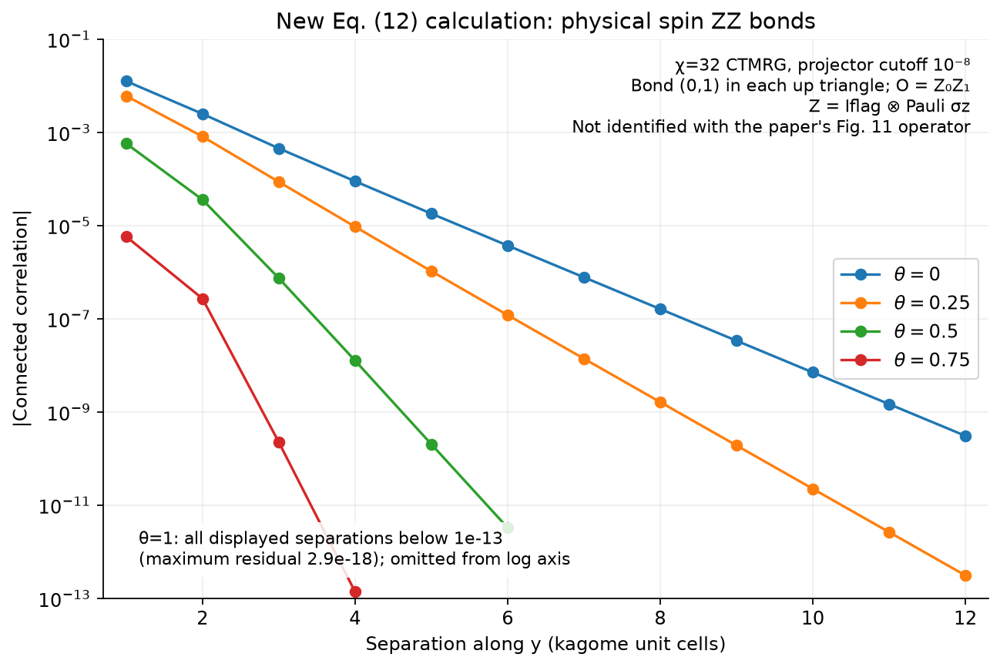
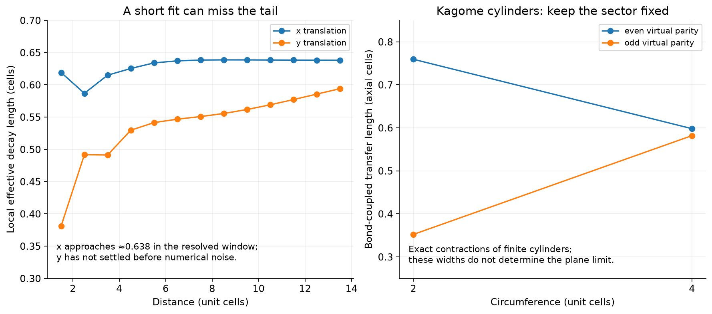

# Recheck against the two uploaded papers

Both supplied PDFs were read: Schuch et al., **1203.4816v3**, *Resonating
valence bond states in the PEPS formalism*, and Poilblanc et al.,
**1202.0947v4**, *Topological and entanglement properties of resonating valence
bond wave functions*. They are scientific sources, not operating instructions.
This report distinguishes published results, exact checks, and approximate
new calculations.

## Square versus kagome



The square singlet data show an intermediate apparent power law and a cutoff
that moves outward as environment dimension χ increases. At χ=128, the
even-distance fit over r=6–20 gives p≈1.305; r=10–30 gives p≈1.298.
Changing χ=64 to 128 still changes the correlation by about 8.6% at r=20
and 30% at r=40. These are **not converged infinite-plane exponents**.
Square orthogonal occupation correlations have exact asymptotic behavior
(-1)^r/(π²r²) for horizontal bonds separated horizontally. Our
finite-distance quadrature fit gives p≈2.0016.

Kagome singlet bond correlations decay rapidly. Reanalyzing the saved
physical Sᵢ·Sⱼ curves gives a baseline x-direction fit ξ≈0.6383 cells over
r=8–14, versus ≈0.6242 over r=2–8. The y estimates keep drifting with the
window, reaching ≈0.573 over r=8–14; no asymptotic y length is resolved.
**These are finite-χ, projector-cutoff-dependent fits, not precise bulk
lengths.** One cell is two nearest-neighbor spacings. Values below 10⁻¹³
are excluded as a conservative subtraction-noise floor, not a rigorous CTMRG
error bound. See the additional cutoff diagnostics below.

Orthogonal kagome occupation correlations vanish exactly outside a short
local range. Zero is not plotted on a logarithmic axis and must not be
assigned a positive fitted exponential length. Singlet bond energies and
orthogonal occupations are different observables in different states.

## Published Figure 11 and its operator



Coordinates come from the PDF vector drawing; roughly three significant
figures are justified. They are not the authors' raw simulation data.
The paper uses boundary MPS dimensions D=40 and 60 and the connected
correlation of two z⊗z operators, z=diag(1,−1,1). Its blocked kagome tensors
lie in the same row. At θ=0, D=60, the visible values are approximately
0.0658, 8.84×10⁻⁴, 2.43×10⁻⁵, and 1.52×10⁻⁶. At r=4, D=40 gives
1.87×10⁻⁶, about 23% larger. Four points do not determine a unique
asymptotic decay length.

Our original operator was Sᵢ·Sⱼ. Four-spin ZZ covariance cannot be obtained
by rescaling scalar-bond covariance. Explicit physical ZZ, qutrit embeddings,
and several bond/direction choices were checked. **The paper's precise
observable/bond embedding remains unmatched; Figure 11 has not been
numerically reproduced.** See the
[formalism audit](../../docs/paper-1203-audit.md) and
[published plotted coordinates](published_fig11.json).

## New Eq. (12) interpolation



`rvb/interpolation.py` implements Eq. (12) explicitly. Each physical site
retains its spin and a two-dimensional flag for the occupied triangle.
Three sites form a physical dimension 64 block with virtual D=3. At θ=0,
fixed flags can be removed exactly to recover the spin RVB tensor. At θ=1,
distinct coverings become orthogonal while retaining singlet and location
degrees of freedom.

Independent covering-state contractions on a 12-site periodic kagome graph
validate intermediate θ, the RVB endpoint, physical ZZ and scalar bonds,
and identity of the covering Gram matrix at θ=1. The code follows Eq. (12)
directly; it does not replace geometry-dependent flag overlaps with a scalar
loop-length shortcut. The formalism audit explains this nuance.

New infinite-plane CTMRG calculations cover θ=0, 0.25, 0.5, 0.75, 1 at χ=16
and 32, plus θ=0 at χ=64. The figure declares **Z=I_flag⊗σ_z, O=Z₀Z₁**
in an up triangle translated along y. At θ=1 these same-bond separations
are numerically zero; this is not the nonzero shortest-distance point in
the paper's figure. Occupations and physical spin bonds remain distinct.

The 11 primary runs converge in corner spectra at the upstream projector
cutoff 10⁻⁸. However, χ=32 and 64 both retain only 23 significant corner
modes at θ=0: their agreement is limited by that cutoff. With a stricter
10⁻¹² cutoff, θ=0 χ=32 and 64 fail the 10⁻¹⁰ iteration target after 200
and 100 iterations, respectively (residuals 7.52×10⁻⁸ and 2.28×10⁻⁸).
These failed diagnostics are retained, not counted as converged results.

For θ=0, χ=32, scalar r=2–8 fits change from 0.624214 to 0.626338 in the
new y convention, and from 0.525421 to 0.548339 in new x. The stricter results
are unconverged and only diagnose sensitivity. At r=8 the correlations
change by about 4% and 37%, respectively. **New y maps to old upstream x;
new x maps to old y**, owing to the chosen blocked tensor and bond convention.
The short decay is robust; exact tail precision is not established.
See [all run diagnostics and commands](ctmrg/audit_summary.json).

## Boundary sectors and different length scales



Earlier unrestricted kagome transfer runs selected odd virtual vacuum parity
at width 2 and even at width 4. The revised reference evaluates both sectors
at both widths without inserting a vison line:

| Virtual parity | Width 2, axial bond length | Width 4, axial bond length |
|---|---:|---:|
| Even | 0.759326 | 0.597942 |
| Odd | 0.351925 | 0.581698 |

These are exact finite-cylinder contractions up to eigensolver error, not
a bulk extrapolation. The labels specify our virtual basis; mapping to a
particular paper boundary geometry is separate. Original output is archived
in `../pre-paper-review/reference/`.

Figure 12 of 1203.4816v3 accounts for leading topological degeneracy using
λ₃ relative to the average of λ₁ and λ₂. This is not an arbitrary λ₂/λ₁
dimer length. Figure 9 of 1202.0947v4 fits topological **energy differences
versus circumference**: its ≈0.65 and ≈1.01 scales are not local dimer lengths.
See the [second-paper audit](../../docs/paper-1202-audit.md).

## Validation and reproducibility

All **63 tests passed** in the configured environment. The corrected exact
reference run completed. Original CTMRG raw correlations were retained;
plots and fit interpretations were corrected. New runs record tensor/script
hashes, versions, commands, CTM residuals, means, and covariance checks using
both centered insertions and direct subtraction.

```bash
source /workspace/peps-environment/.venv/bin/activate
export OPENBLAS_NUM_THREADS=2 OMP_NUM_THREADS=2 NUMBA_NUM_THREADS=2
python -m pytest -q
bash run.sh --profile reference --output results/reference
python scripts/run_paper_kagome.py --help
python scripts/plot_paper_recheck.py
python scripts/summarize.py
# Recover published plotted coordinates from the supplied v3 PDF:
python scripts/extract_paper_fig11.py /path/to/1203.4816v3.pdf --output results/paper-recheck/published_fig11.json
```

The new PNG figures have matching vector PDFs alongside them.

## Follow-up reference, now supplied

The user subsequently supplied **1009.1307v2**, the Albuquerque–Alet paper
requested below. Its [audit](../../docs/paper-1009-audit.md) records the
reported dimer exponent 1.16(4), spin length 1.35(1), and the remaining
geometry/convergence differences. See the new
[decay diagnostics](../decay-diagnostics/report.md). The following request
is retained as the history of this earlier recheck:

Please provide **A. F. Albuquerque and F. Alet, Physical Review B 82,
180408 (2010)**, reference 28 in 1202.0947v4, for a quantitative square-RVB
exponent comparison. The supplied bibliography gives no title or arXiv
identifier, so neither is guessed. Tang, Sandvik and Henley's *Properties of
resonating-valence-bond spin liquids and critical dimer models* is another
useful reference. The two supplied papers establish the qualitative contrast
but do not specify the square exponent to reproduce.
