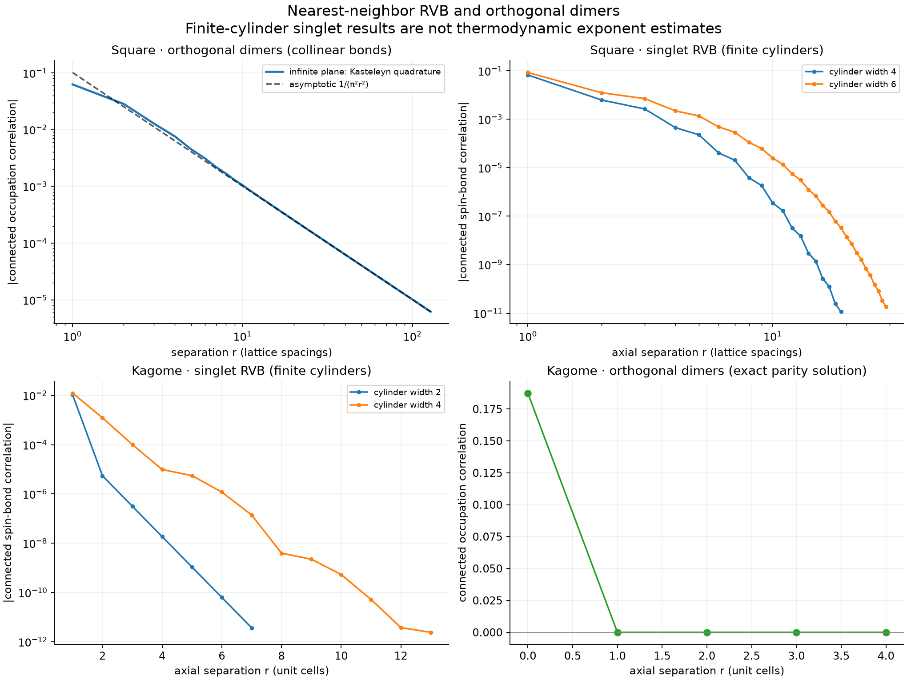
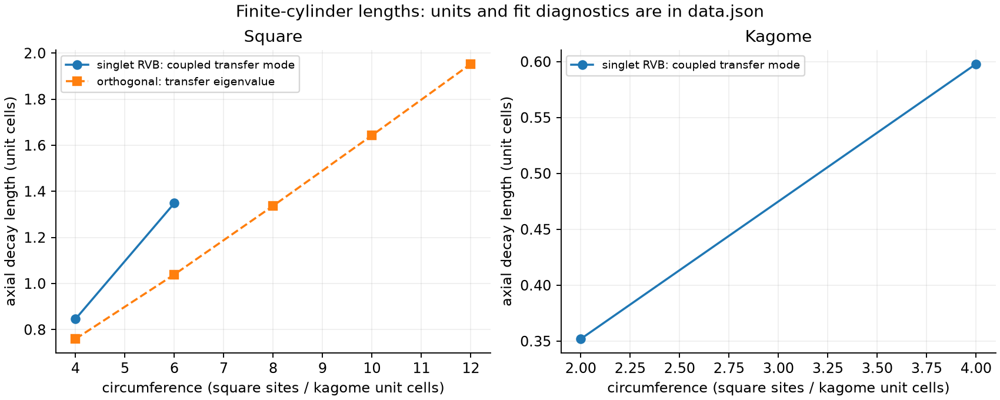

# RVB correlation benchmark results

Generated: 2026-10-19T14:50:57.750144+00:00

These results concern equal-amplitude nearest-neighbor spin-1/2 RVB states and uniform orthogonal dimers, not optimized Heisenberg ground states.

## What was calculated

- Orthogonal square dimers: numerical quadrature of the exact infinite-plane Kasteleyn solution, plus exact finite-cylinder transfer matrices.
- Orthogonal kagome dimers: exact arrow/parity probabilities on a periodic torus; no sampling noise.
- Singlet RVB: exact sparse PEPS transfer matrices on infinite cylinders of specified finite circumference. No boundary bond-dimension truncation is used.
- Small clusters: independent sums over singlet coverings are compared with quimb PEPS contractions.

## Numerical results

The square orthogonal-dimer even-distance fit gives exponent **2.001614**, approaching the exact exponent **2** (fit range [32, 128]). This is not the singlet-RVB exponent.

| Singlet lattice | Width | Mean spin bond | Dimer axial length | Eigenvector residual |
|---|---:|---:|---:|---:|
| square | 4 | -0.395096093 | 0.845836 | 1.1e-15 |
| square | 6 | -0.334211894 | 1.34854 | 4.7e-15 |
| kagome | 2 | -0.231914691 | 0.351925 | 7.8e-16 |
| kagome | 4 | -0.200400140 | 0.597942 | 1.8e-15 |

Lengths count axial unit-cell translations. A kagome unit-cell translation is twice the nearest-neighbor spacing. Width counts square sites or three-site kagome cells. These units must be matched before comparing to a paper.

The lengths come from transfer eigenmodes with nonzero coupling to the physical bond observable; spectral weights, solver residuals and separate tail-fit diagnostics are in `data.json`. Circumference scaling is required for bulk statements. In particular, a finite square-cylinder length does not mean the square plane is gapped.

Both square cylinder models measure circumferential (vertical) bonds separated along the axis. The infinite-plane orthogonal reference instead uses collinear horizontal bonds; it is explicitly labeled separately. Bond orientation can change amplitudes, oscillations, and cancellations of leading terms.

The kagome orthogonal-dimer calculation gives exact zero connected correlation beyond its local support. Exact zeros are not measurements of a small positive exponential decay length.

## Validation

| Cluster | Spins | Coverings | PEPS / covering fidelity | Total spin squared |
|---|---:|---:|---:|---:|
| square | 4 | 2 | 1.000000000000 | -8.9e-16 |
| kagome | 12 | 32 | 1.000000000000 | 3.6e-15 |

## Interpretation and remaining limits

RVB uses physical spin-bond observables B=Si·Sj (equivalently connected singlet-projector correlations, since P=1/4−B). Orthogonal dimers use occupation n=0 or 1. These are different observables in different Hilbert spaces; their absolute amplitudes should not be equated.

An algebraic dimer correlator has no finite asymptotic exponential correlation length. Spin correlations and dimer correlations must not be conflated. On square RVB the critical behavior is in the dimer correlations.

A full reproduction of a paper's singlet-RVB bulk exponent and quoted lengths additionally needs its exact geometry, sector, observable, units and systematic circumference or CTMRG bond-dimension extrapolation. The finite-cylinder data here are a validated starting calculation, not that extrapolation.

See `../upstream` (when generated) for independent peps-torch CTMRG results and `../../docs/libraries-and-references.md` for source and library review.

