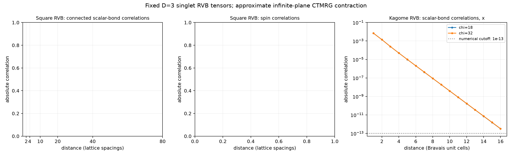

# Independent peps-torch RVB cross-check

These are **fixed D=3 nearest-neighbor singlet RVB tensors**, contracted on the infinite plane with finite-environment CTMRG. No energy optimization was performed. Finite chi is a contraction approximation; this is not yet a completed infinite-chi extrapolation or a full reproduction of a paper's exponent.

Upstream: [https://github.com/jurajHasik/peps-torch.git](https://github.com/jurajHasik/peps-torch.git), commit `239a2e717a567df0ece80a5bce5443a6f78d048b`. The source checkout is unmodified. CPU execution; torch 2.6.0+cpu, numpy 2.5.4, scipy 1.18.1; exact commands are in `manifest.json`.

The adapter in `scripts/run_upstream.py` adds connected dimer correlations via upstream contraction functions. D means the physical bond operator S_i dot S_j. It subtracts the product of the two onepoint functions evaluated in the same finite strip as the four-spin correlator. This avoids a spurious offset from mixing different finite-chi contractions.

These scalar-bond correlations are not the same observable as the z tensor z component-bond correlations plotted in Fig. 11 of Schuch et al., arXiv:1203.4816v3. That paper also studies an interpolation to orthogonal dimers; this report contains only the fixed singlet-RVB endpoint. Agreement of the qualitative decay is not a numerical reproduction of that figure.

## Contraction convergence

Square uses the Frobenius change of the nearest-neighbor reduced density matrix. Kagome uses the criterion recorded in the table: `Partial_energy` monitors one triangle energy, while `SingularValue` monitors all four corner spectra. Passing one of these criteria establishes iteration convergence at that chi, not convergence with chi.

| Lattice | chi | E/site (J=1) | Last step | Criterion | Residual | Tolerance | Passed |
|---|---:|---:|---:|---|---:|---:|---|
| kagome | 18 | -0.393122140093 | 18 | SingularValue | 7.33e-11 | 1e-10 | True |
| kagome | 32 | -0.393123209325 | 19 | SingularValue | 8.09e-11 | 1e-10 | True |

## Square lattice

The dimer function is staggered. The table fits absolute connected correlations on **even separations only**, using an unweighted linear fit of log|C| against log r. No presumed literature exponent is imposed on the figure. Different windows and chi must agree before quoting an asymptotic exponent. The square spin correlation is short ranged; it must not be confused with the critical dimer correlation.

| chi | p, r=4..12 | p, r=6..20 | p, r=10..30 | p, r=20..40 | Leading transfer length |
|---:|---:|---:|---:|---:|---:|

The increasing leading transfer length shows that finite chi cuts off the critical state. It is an effective CTMRG scale, not a converged physical correlation length. Long-distance tails at fixed chi are exponential even for a critical state. The fitted exponents above are descriptive, with no statistical error bars; systematic chi and window effects dominate.

## Kagome lattice

D is the (0,1) bond within the blocked down triangle. Distances are kagome **Bravais unit cells**, equal to two nearest-neighbor spacings. Directions x and y refer to the two blocked lattice directions for that same oriented bond. The 2..8 entries below are descriptive short-window slopes, not established asymptotic correlation lengths. A change with fit window can reflect several transfer modes with different amplitudes.

| chi | Short-window xi_x, r=2..8 | Short-window xi_y, r=2..8 | Generic transfer length, x |
|---:|---:|---:|---:|
| 18 | 0.623496 | 0.525315 | 1.014863 |
| 32 | 0.624214 | 0.525421 | 1.022176 |

### Tail-window diagnostics

Each fit uses every distance in the stated window. A window is marked unresolved if it is incomplete or contains an absolute correlation below 1e-13. Log RMS measures fit curvature; it is not a statistical uncertainty or a CTMRG error bound.

| chi | Direction | Window | Fitted xi (cells) | Log RMS residual |
|---:|---|---|---:|---:|
| 18 | x | 2..8 | 0.623496 | 0.0462879 |
| 18 | x | 4..10 | 0.635185 | 0.00946866 |
| 18 | x | 6..12 | 0.637284 | 0.000807794 |
| 18 | x | 8..14 | 0.637302 | 0.000446007 |
| 18 | y | 2..8 | 0.525315 | 0.0922161 |
| 18 | y | 4..10 | 0.547066 | 0.0327167 |
| 18 | y | 6..12 | 0.558639 | 0.0334852 |
| 18 | y | 8..14 | 0.572268 | 0.0406989 |
| 32 | x | 2..8 | 0.624214 | 0.0445118 |
| 32 | x | 4..10 | 0.635880 | 0.0106082 |
| 32 | x | 6..12 | 0.638267 | 0.000962421 |
| 32 | x | 8..14 | 0.638305 | 0.000476511 |
| 32 | y | 2..8 | 0.525421 | 0.0939961 |
| 32 | y | 4..10 | 0.547779 | 0.0333225 |
| 32 | y | 6..12 | 0.559541 | 0.0335822 |
| 32 | y | 8..14 | 0.573290 | 0.0409968 |

At the largest loaded chi=32, direction x: xi changes from 0.624214 for r=2..8 to 0.638267 for r=6..12 and 0.638305 cells for r=8..14. The two later windows agree within 0.5%, giving a resolved finite-chi tail scale.

At the largest loaded chi=32, direction y: xi changes from 0.525421 for r=2..8 to 0.559541 for r=6..12 and 0.573290 cells for r=8..14. The later-window slopes are still drifting; an asymptotic tail is not established.

The short-window slopes must not be identified with asymptotic lengths. These data do not establish distinct asymptotic x/y lengths. Larger chi and observable-resolved spectra remain necessary for an extrapolated bulk length.

The generic transfer gap can belong to a different channel from the dimer operator and is deliberately reported separately. The ten eigenvalues saved in these runs do not reach the ratio associated with the resolved scalar-bond tail, and their dimer weights have not been evaluated. They also do not implement the topological-sector exclusion and circumference extrapolation in Fig. 12 of arXiv:1203.4816v3.

Kagome values below 1e-13 are omitted from the logarithmic figure. This conservative numerical cutoff guards against cancellation of O(0.04) terms in the connected subtraction; it is not a CTMRG systematic-error estimate. Upstream's chi=18 kagome test reference is E/site=-0.3931221584692804; this is an implementation regression target at finite chi, not an exact thermodynamic energy.

## Repeat the calculation

From the repository, after running `bash scripts/setup-upstream.sh`:

```bash
/workspace/peps-environment/.venv/bin/python scripts/run_upstream.py
# More demanding square calculation, retaining earlier result files:
/workspace/peps-environment/.venv/bin/python scripts/run_upstream.py --square-chi 128 --kagome-chi --distance 96 --max-iter 3000
# Stricter kagome convergence:
/workspace/peps-environment/.venv/bin/python scripts/run_upstream.py --square-chi --kagome-chi 18 32 --ctm-tol 1e-10
```

The default source lives outside the project at `/workspace/peps-environment/upstream/peps-torch`. A missing source directory is cloned at the pinned revision; an existing source at another revision or with tracked changes is rejected. `--source` and `--output` can select other locations. Optional missing YASTN/ArrayFire/cuQuantum notices do not affect these dense CPU contractions.


